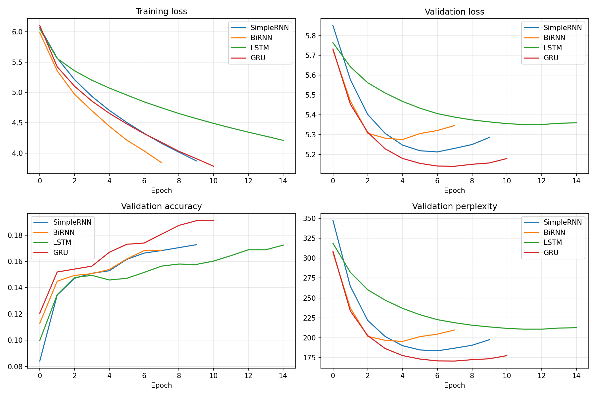
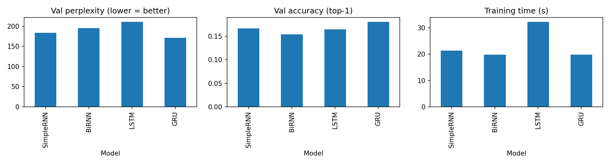
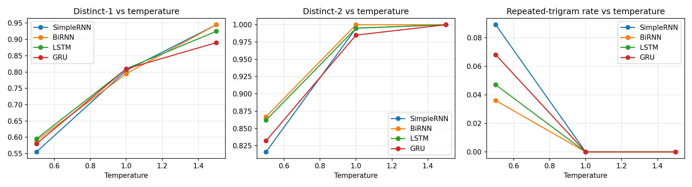

# Alice-Gen: A Comparative Study of RNN Architectures for Next-Word Prediction and Text Generation

**Course:** Foundations of Generative AI (ICT4403) - Assignment 2
**Name:** Mihika Bardhan | **Reg. No.:** 230953122

## 1. Problem statement and objective
Build word-level autoregressive language models that predict the next word and generate text one word at a time. SimpleRNN, Bidirectional RNN (BiRNN), LSTM and GRU models are trained under identical conditions, compared quantitatively (loss, perplexity, accuracy, training time) and qualitatively (coherence, diversity, repetition), and analysed under three sampling temperatures. The aim is to identify the most effective model for autoregressive generation on this dataset.

## 2. Dataset
- **Name:** *Alice's Adventures in Wonderland* by Lewis Carroll (Project Gutenberg eBook #11)
- **Source:** https://www.gutenberg.org/ebooks/11 (plain text used: https://www.gutenberg.org/cache/epub/11/pg11.txt)
- **Characteristics:** a short, public-domain, English novel with a distinctive style: lots of dialogue ("said alice", "said the queen"), recurring characters (the Queen, Gryphon, Mock Turtle, Hatter) and a small vocabulary. Total tokens: **31,281** (about 144k characters), unique tokens: **2,640**, approx. **1,654 sentences**. The most frequent tokens are punctuation and function words (`,` 2,427; `the` 1,651; `.` 999; `and` 874; `to` 729; `a` 637; `she` 541), with `said` and `alice` also in the top 20. Vocabulary used: **2,642** (2,640 unique tokens + `<pad>` + `<unk>`), giving **100% token coverage**.
- **Preprocessing:** removed the Gutenberg header/footer; normalised quotes; lowercased; tokenised into words (keeping apostrophes) and punctuation marks (`. , ! ? ; :`) as separate tokens; built the vocabulary from the 3000 most frequent tokens (the cap was not reached, so no token was mapped to `<unk>`). The book's table of contents and chapter headings were not removed, so words such as "chapter" occasionally appear in generated text.
- **Input-target sequences:** sliding window of 20 tokens as input and the next token as target (`[w1..w20] -> w21`, `[w2..w21] -> w22`, ...). The split is chronological: first 90% of windows for training (28,134 windows; 220 batches of 128) and last 10% for validation (3,127 windows; 31,261 windows in total), so overlapping windows do not leak across the split.

## 3. Models
All models share: Embedding(128) -> recurrent layer (128 units) -> Dropout(0.3) -> Dense(2642, softmax). Only the recurrent layer differs.

| Model | Recurrent layer | Parameters |
|---|---|---|
| SimpleRNN | `SimpleRNN(128)` | 711,890 |
| BiRNN | `Bidirectional(SimpleRNN(128))` | 1,082,962 |
| LSTM | `LSTM(128)` | 810,578 |
| GRU | `GRU(128)` | 778,066 |

Common settings: Adam (lr 1e-3), sparse categorical cross-entropy, batch size 128, max 25 epochs, early stopping on validation loss (patience 3, best weights restored), seed 42.

## 4. Execution steps and dependencies
1. Open `FGAI_Assignment2_Autoregressive_TextGen.ipynb` in Google Colab (a T4 GPU is optional; training takes under 2 minutes in total).
2. Run all cells from top to bottom. The dataset is downloaded automatically.
3. Results, plots and generated text are written to `outputs/`.

Dependencies: see `requirements.txt` (tensorflow, numpy, pandas, matplotlib).

## 5. Results (validation set, best epoch restored)

| Model | Best epoch | Epochs run | Train loss | Val loss | Val perplexity | Val acc (top-1) | Val acc (top-5) | Train time (s) | Sec/epoch |
|---|---|---|---|---|---|---|---|---|---|
| SimpleRNN | 7 | 10 | 4.329 | 5.213 | 183.6 | 16.63% | 35.69% | 21.3 | 2.13 |
| BiRNN | 5 | 8 | 4.444 | 5.275 | 195.4 | 15.38% | 35.50% | 19.8 | 2.47 |
| LSTM | 12 | 15 | 4.417 | 5.351 | 210.8 | 16.44% | 35.88% | 32.2 | 2.15 |
| **GRU** | 8 | 11 | 4.180 | **5.140** | **170.8** | **18.07%** | **37.86%** | 19.8 | **1.80** |

Perplexity = exp(validation loss). A uniform guess over the 2,642-token vocabulary would give a perplexity of about 2,642, so all models learn real structure.




## 6. Model comparison and evaluation

**Quantitative.**
- **GRU** is best on every predictive metric: lowest validation loss (5.14) and perplexity (170.8), highest top-1 (18.1%) and top-5 (37.9%) accuracy. It was also the cheapest per epoch (1.80 s) and, together with BiRNN, had the shortest total training time (about 19.8 s).
- **SimpleRNN** came second (perplexity 183.6), which is notable given it has no gating, and suggests the 20-word context is short enough that vanishing gradients are not a major problem here.
- **BiRNN** has the most parameters (1.08M) and overfitted fastest: its validation loss was lowest at epoch 5 and then rose. Reading the 20-word context in both directions adds capacity, but no new information for predicting a *future* word.
- **LSTM** learned slowest: its training loss was still falling at 4.2 when it stopped, and its validation loss plateaued at 5.35, the highest of the four. It overfitted least, but never reached a low validation loss, so with this small dataset, learning rate and epoch budget it was the weakest. This should not be read as LSTM being inherently worse.
- The differences are modest (perplexity 171-211) and come from a single run per model (seed 42), so rankings between close models (e.g. SimpleRNN vs BiRNN) could change with another seed. Train time includes the three patience epochs after the best epoch and one-off first-epoch overhead.

**Qualitative (generated text, see `outputs/generated_samples.txt`).** At a low temperature all four models produce locally grammatical, book-like phrases ("said alice", "the gryphon", "the mock turtle"), but none stays coherent for 50 words; they drift into generic loops such as "and she was a little way ... and she was a little tone". GRU's output read most naturally and kept dialogue structure best, e.g. *"i don't know, said alice. i hardly think you know. the queen was very ..."* and *"she went on: i shall be no use about it. i don't know, said alice."* SimpleRNN showed the most repetition ("a little little height", "a little little voice"). LSTM was more erratic in word choice ("i is her head!", "very snatch") and, for two different seeds, converged onto the same continuation (*"...as she could not a little were pig, and she felt what at the first..."*), showing it falling into one high-probability path regardless of seed. BiRNN was the most varied at low temperature but least consistent in grammar ("a little going in her head and turned was").

## 7. Sampling-temperature analysis
Four shared seed sequences x three temperatures (0.5, 1.0, 1.5), 50 generated words each. Values are means over the four seeds (Distinct-1 / Distinct-2 = unique unigram / bigram ratio; Rep-3 = fraction of repeated trigrams).

| Model | T=0.5 (D1 / D2 / Rep-3) | T=1.0 | T=1.5 |
|---|---|---|---|
| SimpleRNN | 0.555 / 0.816 / 0.089 | 0.805 / 0.995 / 0.000 | 0.945 / 1.000 / 0.000 |
| BiRNN | 0.590 / 0.867 / 0.036 | 0.795 / 1.000 / 0.000 | 0.945 / 1.000 / 0.000 |
| LSTM | 0.595 / 0.862 / 0.047 | 0.810 / 0.995 / 0.000 | 0.925 / 1.000 / 0.000 |
| GRU | 0.580 / 0.832 / 0.068 | 0.810 / 0.985 / 0.000 | 0.890 / 1.000 / 0.000 |



- **T = 0.5 (conservative):** the most coherent text (fluent phrases, correct dialogue tags) but also the most repetitive: lowest diversity (Distinct-1 about 0.55-0.60) and the only setting with repeated trigrams (3.6-8.9%). The model sticks to high-probability phrases such as "and she was a little ...".
- **T = 1.0 (balanced by the numbers, not by the text):** repetition disappears and diversity jumps (Distinct-1 about 0.80), but coherence drops sharply. Character names and dialogue tags survive, while grammar and meaning break down ("remark. serpent. she doubtful good cause ...").
- **T = 1.5 (random):** near-maximum diversity (Distinct-1 0.89-0.95) but the text is word salad with no coherence ("usually song within confused much likes person already up lessons ...").
- **Caveat on the metrics:** Distinct-2 and Rep-3 saturate at T >= 1.0 (about 1.0 and 0.0), so they no longer discriminate between models there; high diversity at high temperature reflects randomness, not quality. Differences of about 0.01-0.02 between models are within noise for 4 x 50 generated words. Coherence and contextual consistency were judged by reading the samples, which is subjective.
- **Trade-off:** lower temperature buys coherence at the cost of repetition; higher temperature buys diversity at the cost of coherence. For this dataset a value between 0.5 and 1.0 (roughly 0.7-0.8, not tested here) is the likely sweet spot.
- **Across models:** GRU's diversity rises more slowly with temperature (Distinct-1 0.89 at T = 1.5 vs 0.93-0.95 for the others), i.e. its output distribution is sharper and it is less prone to sampling rare words.

## 8. Conclusion
**GRU is the most effective model for autoregressive generation on this dataset.** It has the lowest perplexity (170.8) and highest accuracy (18.1% top-1, 37.9% top-5), the lowest cost per epoch, and generated the most natural-sounding dialogue at a low temperature. The trade-off is slightly higher repetition than BiRNN/LSTM at T = 0.5 (6.8% repeated trigrams), which a slightly higher temperature removes. SimpleRNN was a strong, cheap baseline; BiRNN overfitted fastest; LSTM learned most slowly. Limitations: a small corpus (about 31k tokens), one training run per model, a small set of seed sequences, and front matter (contents list, chapter headings) left in the text; absolute text quality is limited, since no model stays coherent over long spans.

## Repository structure
```
FGAI_Assignment2_Autoregressive_TextGen.ipynb
README.md
requirements.txt
outputs/  (results_table.csv, generation_metrics.csv, generated_samples.txt/.csv, plots, saved models)
```
